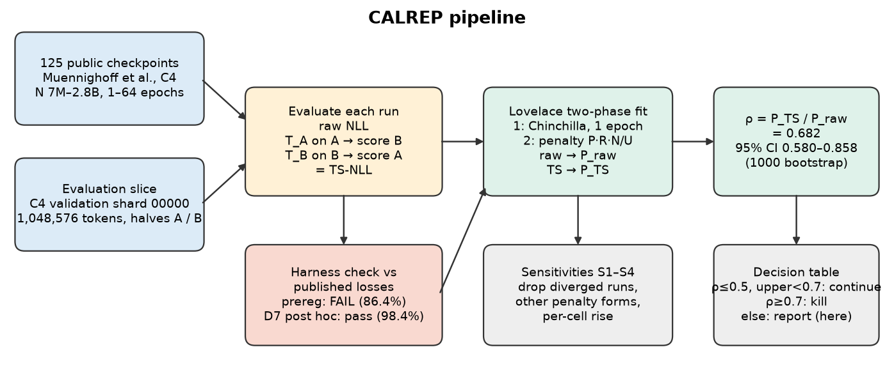
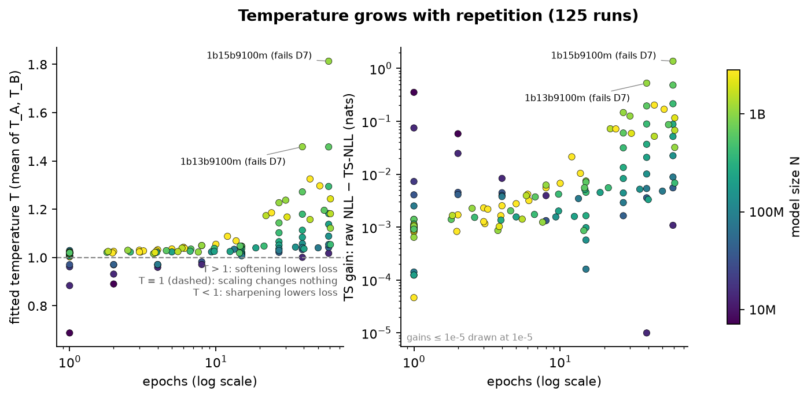
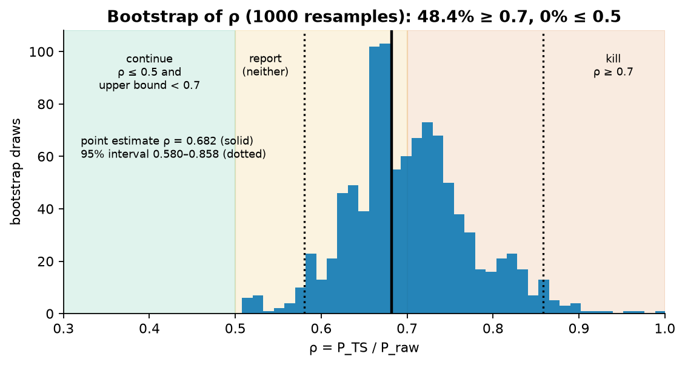
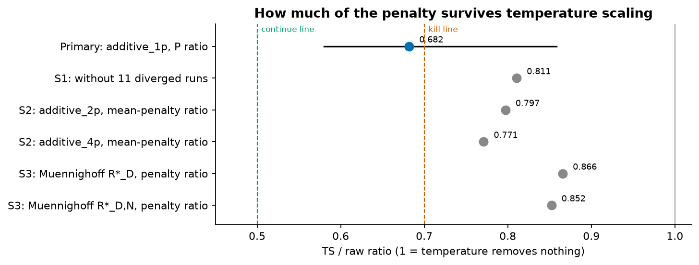
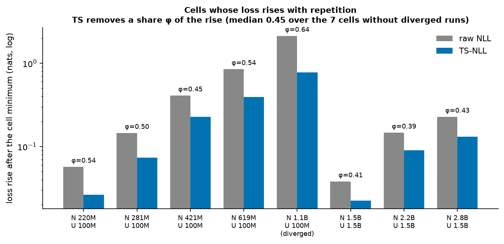
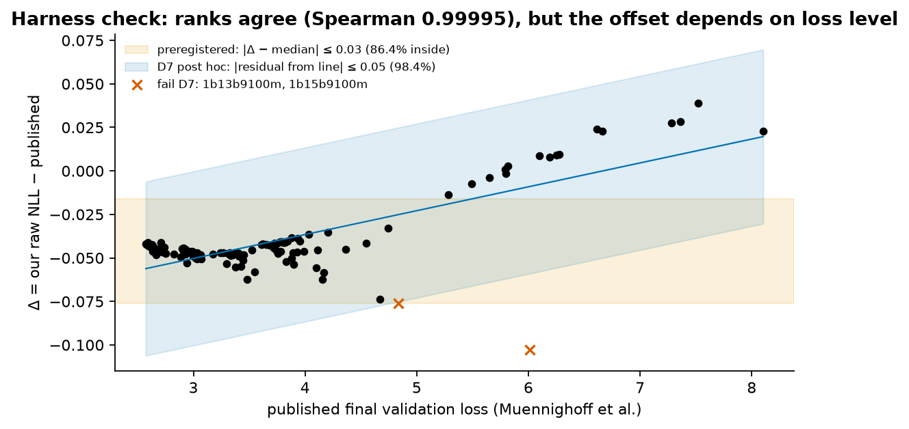

# CALREP: temperature scaling and the overfitting penalty in data-constrained pretraining

Hanyu Yang, independent researcher (`hanyu.yang.92@gmail.com`)

[](https://doi.org/10.5281/zenodo.23283822)
Archived on Zenodo: [10.5281/zenodo.23283822](https://doi.org/10.5281/zenodo.23283822)

> **Question.** When a language model is trained for many epochs on the same data, its validation loss eventually
> rises. Lovelace et al. (arXiv:2605.01640) model this with an additive overfitting penalty P. How much of P disappears
> if each model's loss is measured after one fitted temperature, which only rescales its confidence?
>
> **Answer, on 125 public C4 checkpoints:** about a third. ρ = P_TS / P_raw = **0.682** (bootstrap 95% interval
> 0.580–0.858). Most of the fitted penalty survives this scalar temperature scaling, but in the cells where loss rises
> after its minimum, it removes about **half** of that rise.
>
> **Status: exploratory.** The preregistered evaluator check failed, and a post-hoc criterion was used (see
> [Validity](#validity)).

## At a glance

| | |
|---|---|
| **Models** | 125 of Muennighoff et al.'s public C4 checkpoints (arXiv:2305.16264): 7M–2.8B parameters, 1–64 epochs |
| **Evaluation data** | 1,048,576 tokens of C4 validation (shard 00000, GPT-2 BPE) in 512 sequences of 2,048; 1,048,064 next-token targets scored (512 × 2,047); split by document into halves A and B |
| **Calibration** | One temperature per model, cross-fitted: T_A fitted on A and scored on B, T_B the other way round (Ashukha et al., arXiv:2002.06470 §3.5) |
| **Penalty fit** | Lovelace et al.'s two-phase fit, run on raw loss and on temperature-scaled (TS) loss over the same 125 runs |
| **Uncertainty** | Stratified pairs bootstrap by model size, 1000 resamples, both phases refit each time |
| **Headline** | P: 0.003633 → 0.002478, ρ = 0.682 (0.580–0.858) |
| **Preregistered hypothesis** | ρ ≤ 0.5 with upper bound < 0.7: **not supported** (0% of draws ≤ 0.5, 48.4% ≥ 0.7) |
| **Scope** | C4 only, 1M-token slice, N ≤ 2.8B, one scalar temperature per run, no GPU |



*Figure 1. From checkpoints to ρ.*

## Findings

### 1. The fitted temperature grows with epochs



*Figure 2. Left: fitted temperature per run (T > 1 means softening the predicted probabilities lowers the loss). Right:
how much loss one temperature removes. Colour is model size.*

| Epochs | Runs | Median T | Max T | Median TS gain (nats) |
|---|---:|---:|---:|---:|
| ≤ 1 | 27 | 1.019 | 1.029 | 0.001 |
| 1–4 | 23 | 1.022 | 1.033 | 0.002 |
| 4–16 | 32 | 1.035 | 1.088 | 0.003 |
| 16–64 | 43 | 1.113 | 1.813 | 0.032 |

- Single-epoch models have fitted T close to 1, so one temperature changes little. For the smallest, T < 1 (0.69 at
  7M): sharpening lowers their loss.
- 23 of the 98 multi-epoch runs have T > 1.1. The largest gain is `1b15b9100m` (1.1B, 59 epochs on 100M unique
  tokens): 1.37 nats from the temperature alone.

### 2. Temperature scaling removes about a third of the fitted penalty



*Figure 3. Bootstrap distribution of ρ. Shading marks the point-estimate thresholds of the preregistered rule; "continue"
also requires the bootstrap upper bound to be below 0.7.*

| | Raw NLL | TS-NLL |
|---|---:|---:|
| Penalty P (additive_1p) | 0.003633 | 0.002478 |
| Phase 1 base E, A, α, B, β | 1.987, 565.0, 0.347, 18185, 0.454 | 1.987, 578.9, 0.349, 18179, 0.454 |

- ρ = 0.682, with bootstrap median 0.697 and 95% interval 0.580–0.858.
- The single-epoch base barely moves, so the change in P comes from the multi-epoch runs.
- The decision table gives neither "continue" (ρ ≤ 0.5 with upper bound < 0.7) nor "kill" (ρ ≥ 0.7), so the result is
  reported and the line of work closed.
- ρ = 0.682 includes the two runs that fail even the post-hoc harness rule, `1b13b9100m` and `1b15b9100m`. They have the
  highest temperatures in the set (1.46 and 1.81). ρ without only these two is not computed here.

### 3. Other choices leave more of the penalty in place



*Figure 4. TS / raw ratio of the fitted penalty under each analysis. 1 would mean temperature removes nothing.*

| Analysis | Ratio TS / raw |
|---|---:|
| Primary: additive_1p, ratio of P | 0.682 |
| S1: drop the 11 diverged runs (> 1 nat above their cell minimum) | 0.811 |
| S2: additive_2p, ratio of mean fitted penalty | 0.797 (ratio of P: 0.870) |
| S2: additive_4p, ratio of mean fitted penalty | 0.771 |
| S3 (substituted, see errata): Muennighoff et al.'s effective-data law, Appendix A (R*_D 23.8 → 27.6) | 0.866 |
| S3 (substituted): effective data and parameters, R*_D and R*_N (R*_D 46.1 → 50.6) | 0.852 |

### 4. Where loss actually rises, temperature removes about half of the rise



*Figure 5. For each (model size N, unique data U) cell whose loss rises after its minimum within 64 epochs: the rise in
raw loss and in TS loss, and the share φ that temperature removes.*

| N | U | Max epochs | Rise raw → TS (nats) | φ |
|---|---|---:|---|---:|
| 220M | 100M | 59 | 0.057 → 0.026 | 0.54 |
| 281M | 100M | 59 | 0.146 → 0.074 | 0.50 |
| 421M | 100M | 59 | 0.410 → 0.227 | 0.45 |
| 619M | 100M | 59 | 0.851 → 0.394 | 0.54 |
| 1.1B | 100M | 59 | 2.133 → 0.774 | 0.64 (contains diverged runs) |
| 1.5B | 1.5B | 61 | 0.038 → 0.023 | 0.41 |
| 2.2B | 1.5B | 61 | 0.147 → 0.090 | 0.39 |
| 2.8B | 1.5B | 51 | 0.228 → 0.131 | 0.43 |

Median φ is 0.45 over the 7 cells without diverged runs (range 0.39–0.54) and 0.47 over all 8.

## What this shows and what it does not

| Shows | Does not show |
|---|---|
| Under repetition, part of the rise in held-out loss is removed by one scalar temperature | How much of the penalty other recalibration methods would remove: 68% of P survives scalar temperature scaling on the primary form, 77–87% on the others |
| Fitted temperatures grow with epochs, up to 1.81 | Anything about FineWeb, where Lovelace et al. report their headline P = 0.023 and released no checkpoints |
| About half of the post-minimum rise is removed in the 7 clean rising cells | A bound on ρ under richer recalibration: because the fit is redone, a richer method could move ρ either way |
| | Whether the advice to train larger models for fewer epochs changes |

## Validity



*Figure 6. Our raw loss minus the published loss for each run. Orange band: the preregistered rule. Blue band: the
post-hoc rule D7.*

- The preregistered harness check failed. Ranks agree closely with the published losses (Spearman 0.99995), but only
  86.4% of runs lie within 0.03 nats of the median gap, where 95% was required.
- The gap is close to linear in published loss (slope 0.014), and its cause is not established. A diagnostic fixed
  in advance (D6) rescored four runs on a second, disjoint 1M-token slice. Slice-to-slice changes were at most 0.016
  nats on those four runs; four runs cannot rule out a sampling contribution. Whether it comes from the difference between our slice and the published
  evaluation set, or from the evaluator, was not tested. The four slice-2 results are in `results/parts_slice2/`.
- D7, post hoc: the harness was then judged on residuals from that line (≤ 0.05 for 98.4% of runs). This is the
  criterion D6 had fixed for its other branch, adopted although D6's trigger did not fire. It was adopted after the
  check data and per-run temperatures had been seen, and before the penalty refit and ρ. Every Step 2 number is
  therefore exploratory.
- Raw and TS loss are computed on the same tokens, so ρ compares like with like. That does not make ρ independent of
  the evaluation slice, and the harness check, which tests loss level and ranking, is not a proof that the evaluator
  is correct.

## Repository layout

| Path | Contents |
|---|---|
| `figures/` | Figures 1–6, drawn by `code/make_figures.py` |
| `results/final.json` | Per run: raw NLL, T_A, T_B, TS-NLL (built from `results/parts/` by `code/finalize.py`) |
| `results/parts/` | Raw evaluator output, one file per checkpoint and sequence range |
| `results/parts_slice2/` | D6 diagnostic: four runs on a second slice, built the same way from `c4-validation.00001-of-00008.json.gz` |
| `results/harness_check.json` | Both harness rules and the runs failing each |
| `results/step2_point.json`, `results/step2_boot.json`, `results/boot/` | Point fit, bootstrap merge, bootstrap shards (all 1000 draws) |
| `results/step2_sens.json` | Sensitivities S1–S4 |
| `results/diag/` | Head-split check for the two inferred architectures (D5) |
| `step0/` | Step 0: Lovelace et al.'s P = 0.002857 reproduced from the published losses; the 125-run set |
| `inventory/` | Published losses, pinned Hub revisions and listings |
| `code/` | Evaluator, aggregation, fits, bootstrap merge, figures, diagnostics and cloud-run helpers, at their final version |
| `vendor/dcscaling/` | Lovelace et al.'s fitting code, used for S2 and S3 |
| `PREREGISTRATION.md`, `DEVIATIONS.md`, `RESULTS.md` | The research record (see [Records and errata](#records-and-errata)) |
| `SHA256SUMS` | Checksums of every file in this release |

## Reproduce

Requires Python 3.12 with the packages in `requirements.txt`. CPU only.

```bash
bash fetch_inputs.sh
```

Downloads the datablations notebook and the C4 shard at pinned revisions, checks both, rebuilds the evaluation tokens
and checks them (about 40 MB).

```bash
bash reproduce.sh
```

Self-tests the comparator, then recomputes Step 0, the run set, `final.json` from the parts, the harness check, the
point fit and the sensitivities, merges the shipped bootstrap shards, and compares each with the shipped file. It exits
nonzero on the first mismatch. The default run does not redo the bootstrap; add `--boot` for that (many CPU-hours).
Not covered: Step 1 itself, the D5 head-split and D6 slice diagnostics, and the figures.

```bash
python3 -I code/make_figures.py inputs/parametric_fit.ipynb figures
```

Redraws the figures.

Re-running Step 1 means running `code/calrep_eval.py` once per row of `step0/step1_runset.tsv`, then
`code/finalize.py`: 125 checkpoints, about 240 GB of bf16 weights. We ran it on CPU in sharded cloud jobs
(`code/run_units.py`, `code/setup_cloud.sh`).

## Records and errata

`PREREGISTRATION.md`, `DEVIATIONS.md` and `RESULTS.md` are copied byte-for-byte from the private working repository.
In them, "owner" means the author. The following refer to that repository and are not released: PR and issue numbers,
`CONTEXT.md`, `candidate.json`, `GATE_PASSED` (its intake status), STATUS entries, the units files, the smoke-run logs,
and routine names such as "b3". Dates in the records are as written at the time; they cannot be checked from this
release.

Errata found while preparing this release, recorded 2026-10-10 after all results (they are not part of the deviation log):

| Where | Erratum |
|---|---|
| `RESULTS.md`, Step 1 | "100 runs with published loss < 4.5, sd 0.006" is the 119-run interim figure. On all 125 runs: 104 runs, sd 0.0048. |
| `DEVIATIONS.md` D1, D1b | The spline-versus-exact check errors promised for RESULTS are not there. Four parts carry `exact_check`: largest \|spline − exact\| is 6.4e-5 nats on the 9-point grid, 5.8e-7 on the 25-point grid. |
| `code/calrep_eval.py` docstring | Describes the 25-point grid; the code uses the 9-point grid of D1b. |
| `code/step2_fit.py` docstring | Describes the harness gate inside the fit. The gate and the `harness`, `final_sha256` and `fitter_sha256` output keys were added after the shipped point estimate and bootstrap were computed, so those files lack the keys. The fit computation was not changed, and `reproduce.sh` ignores the three keys. |
| `results/final.json` | `code_sha` is null: no part records the evaluator version, so `code/` is the final version, not attested per part. |
| `PREREGISTRATION.md` S3, `RESULTS.md` sensitivities | Substitution, not logged at the time: the preregistration names Muennighoff et al.'s Appendix F alpha-beta decay law (their Eq. 22, which decays the exponents). The S3 numbers come from the effective-data laws of their Appendix A (`muennighoff_d`, `muennighoff_dn` in Lovelace et al.'s code). The preregistered S3 was not run. Recorded 2026-10-10, after all results. |
| `RESULTS.md` Step 1 | "The 17 runs that fail the preregistered rule are undertrained, high-loss runs": the list includes `1b15b9100m`, a heavily overfit 59-epoch run. |
| `RESULTS.md` Reading | "The fitted overfitting coefficient is mostly not a calibration term" and "near calibrated" hold only for scalar temperature scaling. "Richer recalibration ... bounds ρ from above only" is withdrawn: with the fit redone, no direction follows. |
| `DEVIATIONS.md` D2, D5, D6; `RESULTS.md` Step 1 | "Catches any layout error", "validates" the inferred architecture, and "correctness" overstate the harness check, which tests loss level and ranking. D6's "ρ is unaffected" holds only in the sense that raw and TS use the same tokens. |
| `RESULTS.md`, `PREREGISTRATION.md` | "1,048,576 tokens" is the input size; each checkpoint scores 1,048,064 next-token targets (2,047 per sequence of 2,048; checked in all 149 parts). |

## Credit and licences

| Component | Source | Licence |
|---|---|---|
| `code/`, release scripts | this work | MIT (`LICENSE`) |
| `results/`, `step0/`, `inventory/`, records, figures | this work | CC BY 4.0 (`LICENSE-DATA.md`) |
| `inventory/datablations_published_val_losses.tsv` | extracted from `huggingface/datablations` `utils/parametric_fit.ipynb` (Muennighoff et al.) | Apache-2.0 (`inventory/LICENSE-datablations-Apache-2.0.md`) |
| `vendor/dcscaling/` | Lovelace et al., `justinlovelace/data-constrained-scaling` at d863a5eb; `laws.py`, `fit.py` unmodified, `__init__.py` replaced by an empty file | MIT (`vendor/LICENSE`) |
| Checkpoints, notebook (fetched, not shipped) | `datablations` on the Hugging Face Hub and GitHub | Apache-2.0 |
| Evaluation text (fetched, not shipped) | `allenai/c4` | ODC-BY |

The Zenodo record takes a single licence and is registered as CC BY 4.0; the code in it is offered under MIT as well.

## Use of AI tools

The question came out of an AI-assisted idea search: language models proposed and red-teamed candidate questions, and the
author chose which to pursue. Claude Code (Anthropic; Opus 5.5 in the main session, Sonnet 5.5 in the cloud jobs) wrote
the preregistration, the code and the research records, ran the evaluation, fits and bootstrap, and drafted this README
and the figures. The decisions recorded as the owner's in `DEVIATIONS.md` (D6, D7) and the compute approvals were the
author's. OpenAI Codex reviewed the code during development; each of its comments was fixed or answered. Before release, the package was reviewed by Claude Opus 5.5 and by GPT-6 Pro (ChatGPT), and their findings were fixed.

## Citation

Hanyu Yang (2026). *CALREP: temperature scaling and the overfitting penalty in data-constrained pretraining
(code and results)*, version 1.0.0. Zenodo. https://doi.org/10.5281/zenodo.23283822. See also `CITATION.cff`.
